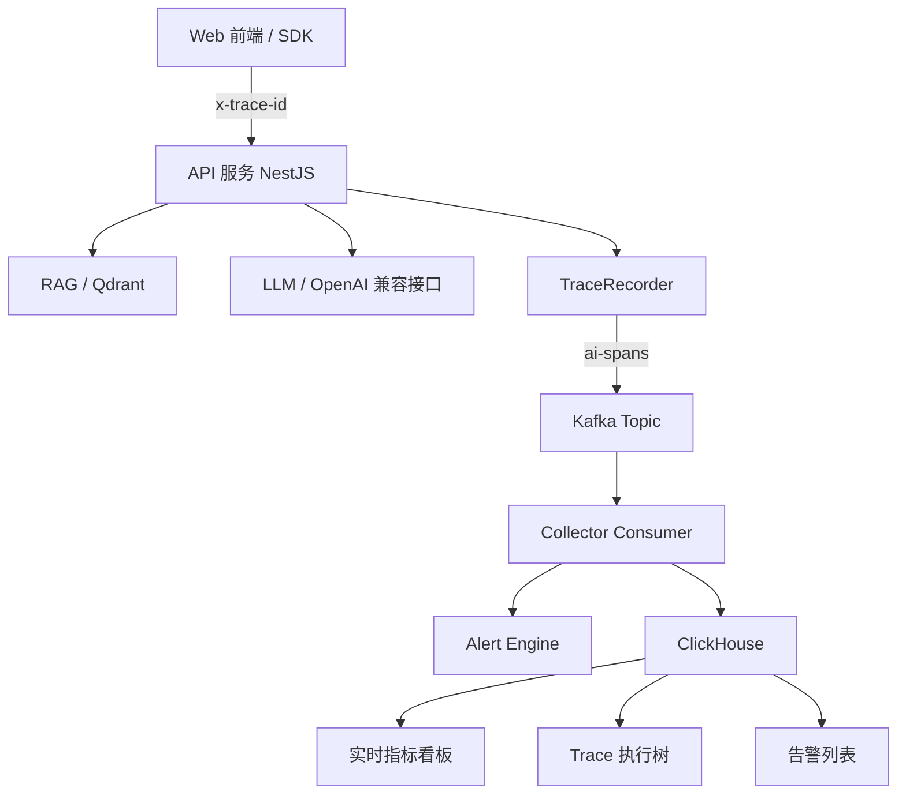
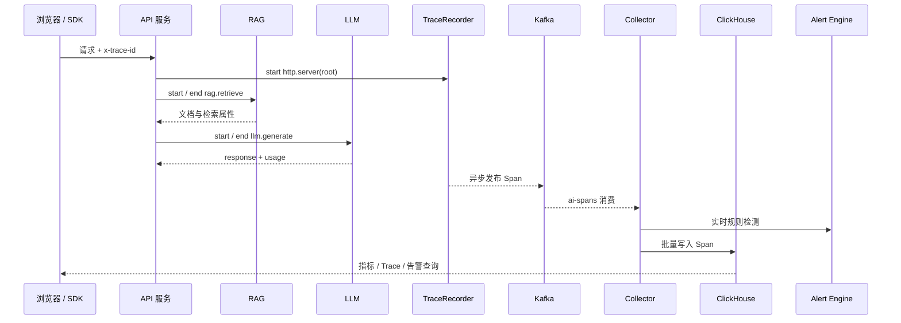

# AI 全链路监控平台

## 1. 背景

### 1.1 建设背景

平台面向需要接入监控能力的 AI 应用，统一采集 Web 前端、API 服务、RAG 检索、LLM 调用、外部工具以及数据库等环节的执行数据，形成以 `traceId` 贯穿的一次请求全链路视图。

当前架构已确定的核心链路为：



### 1.2 产品目标

1. 让接入方用统一 SDK 或 HTTP Header 生成、传递并查询 `traceId`。
2. 让研发和运维能在一处查看请求量、错误率、延迟、Token、成本、RAG 检索和模型调用情况。
3. 通过 Trace → Span → Prompt / RAG 上下文 → 错误的关联，缩短 AI 应用故障定位时间。
4. 通过 Kafka + Collector + ClickHouse 解耦业务请求与监控写入，并支持数据 TTL 控制成本。
5. 在保证敏感数据默认不出域的前提下，逐步补齐类 Sentry 的异常管理和类 LangSmith 的 AI 链路分析能力。

### 1.3 目标用户

| 用户角色 | 主要诉求 |
| --- | --- |
| AI 应用开发者 | 查询一次请求的 Trace、定位接口/RAG/LLM 的慢点和失败原因 |
| 算法 / Agent 工程师 | 分析 Prompt、模型版本、Token、检索召回和执行树 |
| 运维 / SRE | 关注实时指标、异常趋势、告警通知和服务健康度 |
| 平台管理员 | 管理项目、服务、成员、数据保留、采集策略和告警规则 |

### 1.4 范围说明

- **本期范围**：多项目接入、前端 Trace 透传、服务端 Span 记录、Kafka 投递、Collector 入库、ClickHouse 查询、总览看板、Trace 检索与详情、实时告警、LLM/RAG 专项指标。
- **后续范围**：SourceMap 还原、Issue 聚合与生命周期、Release 对比、Prompt 在线编排、评估数据集、AI 辅助根因分析和自动化修复建议。
- **非目标**：本期不替换业务方已有日志平台、APM 或模型网关；平台重点是补齐 AI 链路数据并通过 `traceId` 做统一关联。

## 2. 功能清单

优先级说明：P0 为首个可用版本必须具备；P1 为首期增强；P2 为后续演进。

| 序号 | 功能 | 描述 | 优先级 | 备注 |
| --- | --- | --- | --- | --- |
| 1 | 项目与服务管理 | 创建项目、注册服务、生成接入凭证、配置环境和数据保留策略 | P0 | 支持 dev / staging / prod |
| 2 | 前端 Trace SDK | 生成 Trace ID，注入 `x-trace-id`，采集页面性能、JS/Promise/接口异常 | P0 | 敏感字段默认脱敏 |
| 3 | Trace 透传 | API 服务接收或生成 Trace ID，并向内部服务、RAG、LLM 调用透传 | P0 | 无 Header 时后端兜底生成 |
| 4 | Span 记录器 | 提供 `start / set / setUsage / end` 能力，记录父子关系、状态、耗时和扩展属性 | P0 | 支持 HTTP、RAG、LLM、Tool 等操作 |
| 5 | 异步数据投递 | Span 结束后异步发布到 Kafka `ai-spans`，发布失败降级本地内存队列 | P0 | 不能阻塞业务主链路 |
| 6 | Collector 消费 | 消费 Kafka Span，校验、补充派生字段、写入 ClickHouse | P0 | 支持 Consumer Group 水平扩展 |
| 7 | 实时告警引擎 | 消费 Span 时检测错误、延迟、Token、成本等规则并产生告警 | P0 | critical / warning / info |
| 8 | ClickHouse 存储 | Trace Span 明细按日期分区，支持常用查询排序，默认 30 天 TTL | P0 | TTL 可按项目配置 |
| 9 | 实时指标看板 | 展示请求量、错误率、P50/P95/P99、Token、成本、RAG 命中等指标 | P0 | 支持时间范围、项目、服务、环境筛选 |
| 10 | Trace 检索 | 按 Trace ID、服务、操作、状态、时间、错误文本筛选 | P0 | 支持最近 Trace 快速打开 |
| 11 | Trace 执行树 | 按 `parentSpanId` 还原树状结构，并以时间线展示耗时、状态、Token | P0 | 点击 Span 查看详情 |
| 12 | Trace 详情侧栏 | 查看请求上下文、Span 属性、模型、Prompt/Response 策略、错误堆栈 | P0 | Prompt/Response 默认按策略脱敏 |
| 13 | 告警列表 | 查看告警状态、规则、级别、服务、Trace 关联和发生时间 | P0 | 支持确认、关闭、静默 |
| 14 | 告警规则 | 配置错误率、延迟、Token、成本、RAG 召回等阈值和窗口 | P1 | 支持单指标和组合条件 |
| 15 | 通知渠道 | 飞书、钉钉、邮件、Webhook、短信等通知及分级路由 | P1 | 先实现 Webhook / 邮件 |
| 16 | LLM 调用追踪 | 记录模型名、模型版本、输入/输出/总 Token、TTFT、总耗时和错误分类 | P0 | 兼容 OpenAI 风格 usage |
| 17 | Token 与成本分析 | 按项目、服务、模型、用户、任务、时间聚合 Token 与估算成本 | P1 | 价格表可配置，显示估算标识 |
| 18 | RAG 链路分析 | 记录 topK、召回文档、来源、检索耗时、重排结果和引用信息 | P0 | 重点展示召回为空和耗时异常 |
| 19 | Agent / Tool 执行树 | 用 Span 父子关系展示 Chain、Agent、Tool 调用 | P1 | Tool 名和参数支持脱敏 |
| 20 | Prompt 版本管理 | 保存 Prompt 版本、变更说明、上线状态，并与 Trace 关联 | P2 | 后续支持 A/B 测试 |
| 21 | 评估数据集 | 管理测试样本，支持离线批量运行和 LLM-as-Judge 评分 | P2 | 后续建设 |
| 22 | Issue 聚合 | 按错误类型、堆栈、服务和版本聚合异常，形成 Issue 生命周期 | P2 | 类 Sentry |
| 23 | Release 对比 | 关联代码或模型 Release，对比错误率、延迟、Token 和质量指标 | P2 | 需要版本元数据 |
| 24 | AI 根因分析 | 从同一 Trace 关联前端异常、服务错误、RAG 和 LLM Span，给出定位建议 | P2 | 默认只给建议，不自动修改 |
| 25 | RBAC 与审计 | 项目级成员、角色、操作审计及数据查看权限 | P1 | 最小权限原则 |
| 26 | 数据脱敏策略 | 按字段、服务、项目配置 Prompt、Response、用户标识、文档内容的采集策略 | P0 | 敏感数据默认关闭原文采集 |
| 27 | 健康检查与自监控 | 监控 Kafka 积压、Collector 消费延迟、ClickHouse 写入失败率和查询耗时 | P1 | 平台自身也纳入观测 |

### 2.1 首期 MVP 建议

首期先闭环以下 10 个能力：项目与服务管理、SDK/Trace 透传、服务端 Span、Kafka 投递、Collector 入库、实时告警、总览指标、Trace 检索、执行树详情、LLM/RAG 核心指标。Prompt 管理、评估、Issue、Release 和 AI 根因分析作为后续迭代，避免在数据链路尚未稳定时过早扩展产品面。

## 3. 涉及模块

| 模块 | 职责 | 主要内容 |
| --- | --- | --- |
| Web 控制台 | 查询、分析和配置 | 总览、Trace、告警、AI 链路、项目设置、规则管理 |
| 前端监控 SDK | 浏览器端采集 | Trace 生成、Header 注入、性能指标、前端异常和业务埋点 |
| API 服务（NestJS） | 业务接入与查询 API | Chat / Agent 请求、Trace 查询、项目和规则管理 |
| TraceRecorder | 统一 Span 模型 | 生成 Span ID、维护父子关系、写入属性、统计 Token、结束上报 |
| Kafka Producer | 异步投递 | Topic `ai-spans`、按 `traceId` 分区、发布失败降级 |
| Collector | 消费与转换 | 校验、去重、派生指标、入库、告警检测 |
| Alert Engine | 实时规则检测 | 错误、延迟、Token、成本、RAG 质量和告警状态 |
| ClickHouse | 时序明细和聚合 | `trace_spans`、物化视图、TTL、查询索引/排序键 |
| Qdrant | RAG 向量检索 | 由业务应用调用；平台采集检索 Span，不强制托管向量库 |
| OpenAI 兼容模型服务 | LLM 调用 | 由业务应用调用；采集模型、usage、延迟和错误分类 |
| 权限与审计 | 数据安全 | 项目隔离、角色权限、敏感字段策略、操作日志 |

## 4. 技术方案

### 4.1 核心数据流



### 4.2 Trace 与 Span 约定

```ts
type SpanStatus = 'ok' | 'error'

interface TraceSpan {
  traceId: string
  spanId: string
  parentSpanId?: string
  service: string
  operation: string
  startTime: number
  endTime?: number
  status: SpanStatus
  attributes: Record<string, unknown>
  tokenUsage?: { input: number; output: number; total: number }
  error?: string
}
```

- `traceId`：一次完整请求的唯一标识，由前端生成或 API 服务兜底生成。
- `spanId`：单个操作的唯一标识；`parentSpanId` 用于构建执行树。
- `service`：`web`、`api`、`collector` 或业务服务名。
- `operation`：`http.server`、`rag.retrieve`、`llm.generate`、`tool.call` 等标准化操作名。
- `attributes`：扩展属性，建议约定 `model`、`topK`、`sources`、`promptVersion`、`release` 等键名。

### 4.3 写入与可靠性

1. 业务请求线程只负责生成 Span，并将结束后的 Span 放入异步发送队列。
2. Kafka 消息以 `traceId` 作为 key，保证同一 Trace 尽可能进入同一分区，便于时序消费和局部聚合。
3. Producer 不可用时降级到进程内有界队列，记录自监控指标；队列满时丢弃监控数据并保留采样日志，不能阻塞业务。
4. Collector 对消息做 schema 校验，异常消息进入 DLQ 或错误计数，不得因单条坏消息停止消费。
5. ClickHouse 采用 `event_time` 日分区、`service / operation / event_time / trace_id` 排序键，默认 `TTL event_time + INTERVAL 30 DAY`。
6. 统计类看板优先读取物化视图或预聚合结果，Trace 详情读取明细表。

### 4.4 采集和隐私策略

- Prompt、Response、用户输入、文档正文默认不采集原文，仅采集长度、hash、Token 和摘要字段。
- 采集原文必须由项目管理员显式开启，并支持字段级遮罩、正则脱敏和最大长度限制。
- Trace 查询按项目和环境隔离；生产数据默认禁止跨项目检索。
- 控制台、SDK、Collector 之间使用项目级密钥或短期 Token；密钥只展示一次并支持轮换。

### 4.5 控制台信息架构

```text
控制台
├── 总览
│   ├── 请求量 / 错误率 / 延迟 / Token / 估算成本
│   ├── 服务健康度
│   └── 最近异常与最近 Trace
├── Trace
│   ├── Trace 检索
│   └── Trace 详情：时间线、执行树、Span 属性、错误上下文
├── 告警中心
│   ├── 告警列表
│   ├── 告警规则
│   └── 通知渠道
├── AI 链路
│   ├── 模型调用
│   ├── Token / 成本
│   ├── RAG 检索
│   └── Agent / Tool 执行
├── Prompt 与评估（后续）
└── 项目设置
    ├── 项目 / 服务 / 环境
    ├── 采集与脱敏
    ├── 成员与权限
    └── 数据保留
```

## 5. 数据库变更

### 5.1 ClickHouse 明细表（建议）

```sql
CREATE TABLE IF NOT EXISTS observability.trace_spans
(
    event_time      DateTime64(3),
    project_id      String,
    environment     LowCardinality(String),
    trace_id        String,
    span_id         String,
    parent_span_id  String,
    service         LowCardinality(String),
    operation       LowCardinality(String),
    status          LowCardinality(String),
    start_time      DateTime64(3),
    end_time        DateTime64(3),
    duration_ms     Float64,
    input_tokens    UInt64,
    output_tokens   UInt64,
    total_tokens    UInt64,
    model           LowCardinality(String),
    attributes      String,
    error           String
)
ENGINE = MergeTree
PARTITION BY toDate(event_time)
ORDER BY (project_id, environment, service, operation, event_time, trace_id)
TTL event_time + INTERVAL 30 DAY;
```

### 5.2 配置库表（建议由 API 服务使用 PostgreSQL / MySQL）

| 表 | 用途 | 关键字段 |
| --- | --- | --- |
| `projects` | 项目和数据保留策略 | `id`、`name`、`retention_days`、`status` |
| `services` | 服务注册 | `id`、`project_id`、`name`、`environment`、`sdk_version` |
| `project_keys` | 接入密钥 | `id`、`project_id`、`key_hash`、`last_used_at`、`revoked_at` |
| `alert_rules` | 告警规则 | `id`、`project_id`、`metric`、`operator`、`threshold`、`window_seconds` |
| `alert_items` | 告警实例 | `id`、`rule_id`、`trace_id`、`level`、`status`、`created_at` |
| `members` | 成员和角色 | `project_id`、`user_id`、`role` |
| `audit_logs` | 操作审计 | `actor_id`、`action`、`resource`、`created_at` |

### 5.3 迁移与回滚

- 新表采用幂等 migration，先创建表和索引，再灰度开启写入。
- ClickHouse 字段新增优先使用 Nullable 或默认值，避免 Collector 与查询服务版本不一致。
- 回滚应用版本时保留新增字段，不做破坏性删除；TTL 调整先评估存储容量与合规要求。

## 6. 接口设计

### 6.1 Trace 查询

| 项目 | 内容 |
| --- | --- |
| 方法 / 路径 | `GET /api/v1/traces` |
| 用途 | 按条件分页查询 Trace 列表 |
| 请求参数 | `projectId`、`environment`、`traceId?`、`service?`、`status?`、`from`、`to`、`page`、`pageSize` |
| 响应字段 | `items[] { traceId, rootOperation, services, status, durationMs, totalTokens, startedAt }`、`total` |
| 权限 | 项目成员，至少具备 `trace:read` |

### 6.2 Trace 详情

| 项目 | 内容 |
| --- | --- |
| 方法 / 路径 | `GET /api/v1/traces/:traceId` |
| 用途 | 获取一次请求的 Span 明细和执行树 |
| 请求参数 | 路径参数 `traceId`；查询参数 `includeContent?` |
| 响应字段 | `traceId`、`rootSpan`、`spans[]`、`summary`、`errors[]`、`redaction` |
| 权限 | 项目成员；`includeContent=true` 需要 `trace:content:read` |

### 6.3 Span 上报

| 项目 | 内容 |
| --- | --- |
| 方法 / 路径 | `POST /api/v1/ingest/spans` |
| 用途 | SDK 或服务端批量上报已结束 Span；Kafka 仍为推荐的服务端内部链路 |
| 请求体 | `{ projectKey, spans: TraceSpan[] }` |
| 响应字段 | `{ accepted, rejected, requestId }` |
| 权限 | 项目写入 Token；仅允许上报，不允许查询 |

### 6.4 指标总览

| 项目 | 内容 |
| --- | --- |
| 方法 / 路径 | `GET /api/v1/metrics/overview` |
| 用途 | 获取总览卡片、趋势和服务排行 |
| 请求参数 | `projectId`、`environment`、`from`、`to`、`groupBy?` |
| 响应字段 | `summary`、`timeseries[]`、`services[]`、`topModels[]` |
| 权限 | 项目成员，至少具备 `metrics:read` |

### 6.5 告警

| 项目 | 内容 |
| --- | --- |
| 方法 / 路径 | `GET /api/v1/alerts`、`PATCH /api/v1/alerts/:id` |
| 用途 | 查询、确认、关闭告警 |
| 请求参数 | `level?`、`status?`、`service?`、`from`、`to`；更新体 `status`、`note?` |
| 响应字段 | `id`、`level`、`rule`、`message`、`traceId`、`status`、`createdAt` |
| 权限 | 查看需要 `alert:read`；更新需要 `alert:manage` |

### 6.6 统一错误码

| 错误码 | 含义 |
| --- | --- |
| `AUTH_001` | Token 无效或已撤销 |
| `PROJECT_001` | 无项目访问权限 |
| `TRACE_001` | Trace 不存在或已过期 |
| `INGEST_001` | Span schema 校验失败 |
| `QUERY_001` | 查询时间范围或分页参数非法 |
| `SYSTEM_001` | 依赖服务不可用，已进入降级 |

## 7. 非功能需求

| 类别 | 要求 |
| --- | --- |
| 性能 | P95 Trace 查询 < 2 秒；总览常用时间范围查询 < 3 秒；上报接口不因 ClickHouse 写入阻塞业务 |
| 可用性 | Kafka、ClickHouse 短时不可用时，业务请求仍可用；Collector 支持重启恢复和重复消息幂等 |
| 扩展性 | Collector 支持 Consumer Group 水平扩展；API 查询与写入可独立扩容 |
| 数据安全 | 项目隔离、密钥哈希存储、传输加密、敏感数据默认脱敏、审计关键操作 |
| 可观测性 | 平台自身输出 Kafka lag、消费延迟、写入失败率、丢弃数、查询耗时和告警处理耗时 |
| 兼容性 | SDK 支持 TypeScript/浏览器；服务端协议兼容 OpenAI `usage` 字段；Span schema 版本化 |
| 成本 | ClickHouse 默认 30 天 TTL；长周期指标使用聚合表；支持采样率与内容采集开关 |

## 8. 验收标准

1. 新建项目后可生成接入凭证，并能在测试环境登记至少一个服务。
2. 前端发送请求时带有 `x-trace-id`，API 未收到该 Header 时能生成 Trace ID 并在响应中返回。
3. 一次包含 RAG 和 LLM 调用的请求至少产生 `http.server`、`rag.retrieve`、`llm.generate` 三类 Span，父子关系可还原。
4. Span 结束后业务请求不等待 ClickHouse 写入；Kafka 或 Collector 暂不可用时接口仍能返回业务结果。
5. Collector 能消费 `ai-spans`，将数据写入 ClickHouse，并能按 Trace ID 查询完整链路。
6. Trace 详情页能展示总耗时、每个 Span 的耗时、状态、模型、Token 以及错误信息。
7. 当 Span 状态为 error 或延迟超过阈值时，告警列表在可接受延迟内生成对应告警，并支持关联 Trace。
8. 总览页支持时间范围、项目、服务、环境筛选，并返回请求量、错误率、P95、Token 和成本估算。
9. 默认不展示 Prompt/Response 原文；只有显式开启采集和具有内容权限时才可查看脱敏内容。
10. 超过配置 TTL 的明细数据会被自动清理，聚合指标不因明细清理而失效。

## 9. 风险与待确认事项

| 风险 / 待确认项 | 建议 |
| --- | --- |
| 业务方是否需要采集 Prompt / Response 原文 | 默认关闭；先落地字段级脱敏、摘要和 hash，再按项目开关放量 |
| 项目和用户身份体系 | MVP 可使用平台本地 RBAC；后续接入企业 SSO / OAuth |
| 成本计算口径 | 需要确认各模型价格表、折扣、缓存 Token、重试是否单独计费 |
| Qdrant 调用边界 | 方案只约束 RAG Span 协议，不强制所有向量数据进入平台 |
| Kafka 不可用时的数据可靠性 | 确认本地队列容量、丢弃策略、是否需要磁盘缓冲或本地 WAL |
| ClickHouse 保留周期 | 文档以 30 天为默认，生产需要按合规和容量确认 |
| 前端原型到正式产品的差距 | 当前原型用于评审信息架构和交互，不代表视觉规范或最终接口实现 |
| AI 根因分析的数据权限 | 必须限制在用户可访问的 Trace 范围内，并提供可解释的证据链 |

